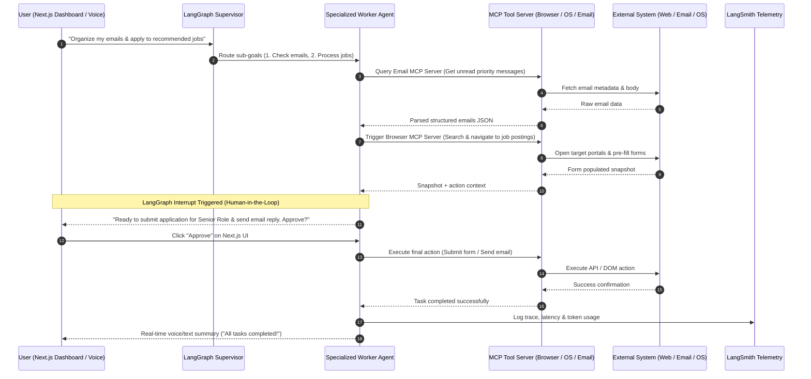

# Universal Autonomous Personal AI Assistant ("Jarvis-Style") — M.I.R.A.S

> [!IMPORTANT]
> **Production Architecture**: **Stateful Multi-Agent Graph (LangGraph) + Extensible Model Context Protocol (MCP) + Next.js 14 Multimodal Dashboard**  
> An enterprise-grade, general-purpose autonomous personal AI assistant capable of executing _any task_ for the user—from real-time voice/text conversation and daily task management, to web automation (job applications, research, booking), local OS/file operations, personal knowledge memory (RAG), and proactive workflow execution.

---

## ⚡ 60-Second Executive Summary (TL;DR)

- **Universal Capability via Model Context Protocol (MCP)**: Pluggable MCP architecture allowing the AI assistant to act on the physical computer and web—managing emails, controlling local OS/filesystem, executing web browser automation (job applications, flight bookings, form filling), and querying third-party APIs.
- **Multimodal & Voice-First Core**: Ultra-low latency real-time voice and text interaction via WebSockets streaming over **FastAPI** backend and **Next.js 14 (TypeScript)** frontend.
- **Stateful Multi-Agent Intelligence (LangGraph)**: Powered by a master **Supervisor Agent** that orchestrates specialized sub-agents (Executive Assistant, Web & OS Automation Agent, Personal Knowledge Agent, Coding & Career Agent).
- **Personal Knowledge Memory (RAG + Graph)**: Dual-layer memory system combining Dense Vector Search (Qdrant/PGVector) for personal documents and a Knowledge Graph (Neo4j) for long-term personal context, habits, preferences, and entity tracking.
- **Human-in-the-Loop (HITL) Safety Guard**: Built-in **LangGraph Interrupts** requesting human authorization before taking irreversible external actions (sending emails, making payments, submitting official applications).
- **Production Observability & Tracing (LangSmith)**: Full end-to-end tracing of multi-agent loops, latency breakdown, token usage optimization, and prompt evaluation.
- **Top MNC Career Portfolio**: Built to showcase senior-level AI system engineering capabilities (LangGraph state machines, MCP tool protocol, hybrid RAG, Next.js 14, async Python microservices).

---

## 📑 Documentation Index

- 🚀 **[Comprehensive Feature Plan & Roadmap](./docs/FEATURE_PLAN.md)**: Architecture overview, multi-agent engine, implemented features, and roadmap.
- 📱 **[Complete Build, Install & Run Guide](./docs/BUILD_AND_RUN_GUIDE.md)**: Step-by-step instructions for Laptop browser, Mobile Expo Go, building APK (EAS Cloud & Local Gradle), phone installation, and backend setup.

---

### In-Page Sections

1. [Tech Stack at a Glance](#-tech-stack-at-a-glance)
2. [Architecture & Workflow Diagrams](#-architecture--workflow-diagrams)
   - [1. Universal Multi-Agent System Architecture (LangGraph + MCP)](#1-universal-multi-agent-system-architecture-langgraph--mcp)
   - [2. General Task Execution Workflow (With HITL Authorization)](#2-general-task-execution-workflow-with-hitl-authorization)
3. [Universal Capability Modules (MCP Tools)](#-universal-capability-modules-mcp-tools)
4. [Failure Mode & Resilience Rules](#-failure-mode--resilience-rules)
5. [Interview Playbook (Bulletproof MNC Senior AI Engineer Q&A)](#-interview-playbook-bulletproof-mnc-senior-ai-engineer-qa)
6. [Summary Comparison: Basic Chatbot vs. Universal Personal AI Assistant](#-summary-comparison-basic-chatbot-vs-universal-personal-ai-assistant)
7. [Backend Execution & Process Structure](#-backend-execution--process-structure)

---

## 🛠 Tech Stack at a Glance

| Layer                    | Technology                                       | Primary Purpose                                                             | Key Benefit                                                          |
| :----------------------- | :----------------------------------------------- | :-------------------------------------------------------------------------- | :------------------------------------------------------------------- |
| **Frontend Client**      | Next.js 14 (TypeScript, Tailwind CSS, Shadcn UI) | Real-time voice/chat UI, active task dashboard, tool execution visualizer   | SSR performance, WebSockets/WebRTC voice streaming, modern UI        |
| **Backend Gateway**      | FastAPI (Python 3.11+)                           | Async API gateway, WebSocket connection manager, streaming server           | Non-blocking high throughput, Pydantic type safety, async events     |
| **Agent Orchestration**  | LangGraph                                        | Stateful multi-agent state graph, cyclic routing, human-in-the-loop         | Deterministic control over LLM loops, pause/resume state execution   |
| **LLM Abstraction**      | LangChain Core                                   | Model routing (OpenAI, Anthropic Claude, Gemini), structured output parsing | Unified interface across LLM providers with automatic retry fallback |
| **Tool Integration**     | Model Context Protocol (MCP)                     | Standardized tool connection protocol (Browser, OS, APIs, DBs)              | Decoupled tool sandbox; unlimited pluggable capabilities             |
| **Web & Browser Engine** | Playwright / Browserbase (MCP Server)            | Automated web browsing, DOM interaction, form filling, scraping             | Handles job portals, travel sites, web tools, dynamic content        |
| **Local OS Control**     | Custom Python MCP Server                         | File system management, local CLI command execution, system stats           | Direct desktop integration for productivity and file handling        |
| **Observability**        | LangSmith                                        | Multi-agent execution tracing, prompt evaluation, token & cost tracking     | Step-by-step trace visualization and performance optimization        |
| **Vector DB (RAG)**      | Qdrant / PGVector                                | Storage for personal notes, docs, resume, conversation transcripts          | Sub-20ms hybrid vector search with metadata filtering                |
| **Knowledge Graph**      | Neo4j / NetworkX                                 | Entity graph memory (People, Projects, Preferences, Work History)           | Structured multi-hop relational context retrieval                    |
| **State Persistence**    | PostgreSQL / Redis                               | LangGraph checkpointer for state preservation across sessions               | Time-traveling agent state, instant recovery on worker restart       |

---

## 🏗 Architecture & Workflow Diagrams

### 1. Universal Multi-Agent System Architecture (LangGraph + MCP)

> [!NOTE]
> **Orchestrator Pattern**: The **Supervisor Agent** routes incoming voice/text requests to specialized domain sub-agents. External actions are safely delegated to independent **MCP Servers**.

```mermaid
flowchart TD
    User([User / Voice & Text UI]) <-->|WebSockets / WebRTC| NextJS[Next.js 14 Dashboard]
    NextJS <-->|Async Event Stream| FastAPI[FastAPI Gateway]

    subgraph LangGraph Multi-Agent Core
        FastAPI --> Supervisor[Master Supervisor Agent]

        Supervisor -->|Voice Chat & General Q&A| VoiceAgent[Conversational & Voice Agent]
        Supervisor -->|Memory & Document Lookup| MemoryAgent[Personal Knowledge Agent]
        Supervisor -->|Web Automation & Tasks| WebAgent[Web & Task Automation Agent]
        Supervisor -->|Career & Job Applications| CareerAgent[Career & Application Agent]
        Supervisor -->|Code & System Tasks| DevAgent[Developer & OS Agent]

        MemoryAgent <-->|Hybrid Search| RAG[(Vector DB + Neo4j Graph Memory)]
    end

    subgraph MCP Tool Layer (Modular Capabilities)
        WebAgent <-->|MCP Protocol| BrowserMCP[Browser Automation MCP Server\nPlaywright / Web Scraper]
        CareerAgent <-->|MCP Protocol| CareerMCP[Career & Form Automation MCP Server]
        DevAgent <-->|MCP Protocol| SystemMCP[OS & Filesystem MCP Server\nTerminal / File Ops]
        Supervisor <-->|MCP Protocol| ServiceMCP[Google Workspace / Email / Calendar MCP]
    end

    subgraph Human-in-the-Loop Safety Checkpoint
        LangGraph -.->|Interrupt for Sensitive Action| HITL[Next.js Action Approval Modal]
        HITL -.->|User Approves / Rejects| LangGraph
    end

    subgraph Tracing & Telemetry
        LangGraph -.->|Full Graph Telemetry| LangSmith[LangSmith Observability]
    end
```

---

### 2. General Task Execution Workflow (With HITL Authorization)

> [!TIP]
> **Universal Action Flow**: The assistant accepts natural language goals, dynamically formulates execution plans using MCP tools, requests approval for impactful actions, and logs full trace history to LangSmith.



---

## 🛠 Universal Capability Modules (MCP Tools)

The assistant is non-restrictive and can be expanded continuously by adding new **MCP Servers**:

1. **Web & Browser Automation (Playwright MCP)**:
   - Automated web navigation, form filling, web scraping, price tracking.
   - Job portal application automation (LinkedIn, Greenhouse, Lever, Indeed).
   - Online reservations, flight search, and web task execution.

2. **Personal Knowledge & Memory (RAG + Knowledge Graph MCP)**:
   - Indexing personal PDFs, notes, resume history, bookmarks, and transcripts.
   - Long-term memory recall (_"What did I discuss with X last week?"_).

3. **Office & Communication (Workspace MCP)**:
   - Email drafting, reading, and inbox summarization (Gmail / Outlook).
   - Calendar scheduling, meeting reminders, and daily planner generation.

4. **Local Operating System & Code (Desktop MCP)**:
   - File manipulation (reading, organizing, generating PDFs/Markdown).
   - Code execution, terminal command running, script debugging.

---

## ⚡ Failure Mode & Resilience Rules

> [!WARNING]
>
> - **Rule 1 (Human-in-the-Loop Guardrail)**: Any external action causing side effects (sending email, spending money, submitting job applications, deleting files) **MUST** invoke `interrupt_before` in LangGraph to obtain explicit user confirmation.
> - **Rule 2 (CAPTCHA & Anti-Bot Failover)**: When browser automation encounters CAPTCHA or Cloudflare protection, the Browser MCP Server pauses execution and alerts the Next.js UI for **Manual User Intervention**.
> - **Rule 3 (State Recovery & Persistence)**: LangGraph checkpointer (Postgres/Redis) ensures that if an API call fails mid-task, the assistant resumes seamlessly from the last completed node.
> - **Rule 4 (Pydantic Output Validation)**: All LLM outputs bound for MCP tool calls must strictly pass Pydantic schema validation; invalid parameters trigger automated self-correction loops.

---

## 🎤 Interview Playbook (Bulletproof MNC Senior AI Engineer Q&A)

### Q1: Why design a Universal AI Assistant using LangGraph instead of standard LangChain or AutoGen?

- **Stateful Cyclic Execution**: Real-world tasks (e.g., browse web $\rightarrow$ analyze error $\rightarrow$ retry $\rightarrow$ request approval $\rightarrow$ execute) require cyclic graphs, whereas standard chains are acyclic.
- **Granular Control & State Memory**: LangGraph provides explicit state management via `StateGraph`, enabling state persistence (Postgres/Redis) and time-travel debugging.
- **Native Human-in-the-Loop**: Built-in interrupt hooks allow suspending execution safely while waiting for user interaction on the frontend UI.

### Q2: What role does the Model Context Protocol (MCP) play in making this assistant "do anything"?

- **Standardized Tool Architecture**: MCP decouples the core AI agent logic from tool execution. Adding a new capability (e.g., Smart Home control or Figma automation) requires writing an isolated MCP server without refactoring agent code.
- **Security & Isolation**: MCP servers run in isolated sandboxed processes, preventing unvalidated LLM actions from harming the core backend gateway.

### Q3: How do you handle long-term personal memory without exceeding LLM context windows?

- **Dual-Layer Memory (RAG + Knowledge Graph)**: Daily notes and documents are indexed in a Vector DB (Qdrant) for semantic search, while core entities (projects, people, preferences, work history) are stored in a Neo4j Knowledge Graph.
- **Context Compression & Summarization**: LangGraph maintains a dynamic `SummaryBufferMemory` that continuously compresses past conversation history while retaining key facts.

### Q4: How do you trace, debug, and evaluate multi-agent performance in production?

- **LangSmith Tracing**: Every multi-agent handoff, LLM prompt call, tool invocation, and token consumption count is streamed directly to LangSmith.
- **Evaluation Datasets**: LangSmith dataset tests run automated benchmarks against the agent graph to measure task success rate, latency, and hallucination metrics before releasing updates.

---

## 📊 Summary Comparison: Basic Chatbot vs. Universal Personal AI Assistant

| Dimension               | Basic Chatbot (ChatGPT Wrapper)  | Universal Personal AI Assistant Platform                   |
| :---------------------- | :------------------------------- | :--------------------------------------------------------- |
| **Scope of Action**     | Informational text response only | Full task execution on Web, OS, Email, APIs, & Job Portals |
| **Architecture**        | Stateless single-turn API call   | Stateful Multi-Agent Graph (LangGraph)                     |
| **Tool Standard**       | Hardcoded function calling       | Pluggable Model Context Protocol (MCP)                     |
| **Memory System**       | Temporary context window         | Hybrid RAG (Vector Search) + Graph Memory (Neo4j)          |
| **Safety & Control**    | Uncontrolled generation          | Human-in-the-Loop (HITL) interrupt authorization           |
| **Observability**       | Console print statements         | End-to-end multi-agent tracing & evaluation via LangSmith  |
| **Career & MNC Impact** | Beginner / Student project       | **Flagship Senior AI Platform Engineer Project**           |

---

## ⚙️ Backend Execution & Process Structure

```
backend/
├── app/
│   ├── api/                 # FastAPI routes (chat, websocket, actions, audio)
│   ├── core/                # Core configurations, logging, security
│   ├── graph/               # LangGraph state machine, nodes, and edges
│   │   ├── supervisor.py    # Master router / supervisor node
│   │   ├── state.py         # Agent state schemas (Pydantic / TypedDict)
│   │   └── agents/          # Specialized sub-agents
│   ├── mcp/                 # MCP client connectors & protocol handlers
│   │   ├── browser_mcp.py   # Browser & web automation connector
│   │   ├── system_mcp.py    # Local OS & filesystem connector
│   │   └── email_mcp.py     # Workspace & email integration
│   ├── memory/              # Dual-layer memory engine (Vector DB + Neo4j Graph)
│   └── services/            # Audio transcription, TTS, LLM providers
├── .env.local               # Local environment variables & API credentials
├── .gitignore
├── requirements.txt         # Python package dependencies
└── main.py                  # Backend entry point
```
