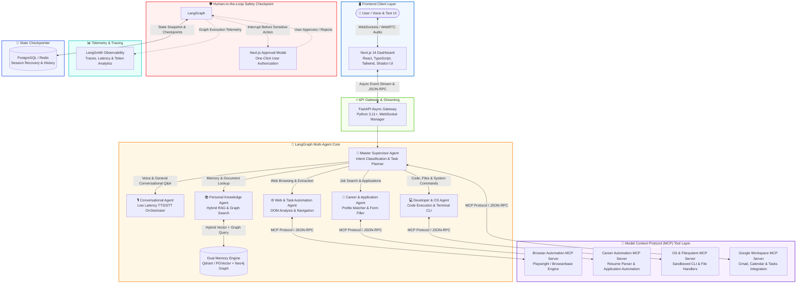
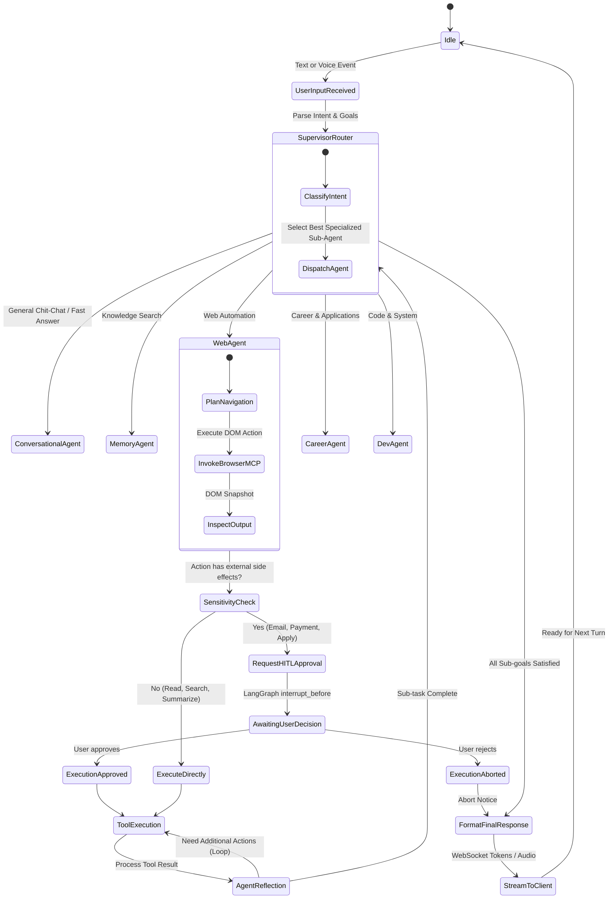
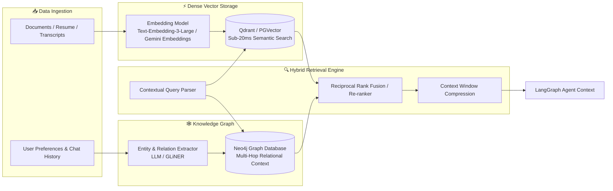

# 🏗 M.I.R.A.S System Architecture Diagram & Specification

> [!IMPORTANT]
> **Production Architecture**: **Stateful Multi-Agent Graph (LangGraph) + Extensible Model Context Protocol (MCP) + Next.js 14 Multimodal Dashboard**  
> An enterprise-grade, general-purpose autonomous personal AI assistant capable of executing _any task_ for the user—from real-time voice/text conversation and daily task management, to web automation (job applications, research, booking), local OS/file operations, personal knowledge memory (RAG), and proactive workflow execution.

---

## 1. High-Level Multi-Agent System Architecture

---

## 2. Component Architecture Breakdown

### 2.1 Frontend Client Layer (Next.js 14)

- **Framework**: Next.js 14 App Router with TypeScript.
- **UI Components**: Tailwind CSS, Shadcn UI primitives, Radix UI.
- **Real-Time Communication**: Native WebSocket client for real-time streaming of tokens, agent thoughts, tool execution cards, and live audio chunks.
- **Human-in-the-Loop UI**: Interactive action approval modals rendered dynamically when LangGraph triggers an `interrupt_before` condition (e.g., confirming an email send or job application submission).

### 2.2 API Gateway & Streaming Layer (FastAPI)

- **High Throughput Asynchronous Server**: Python 3.11+ using `asyncio` and `uvicorn`.
- **WebSocket Manager**: Handles bidirectional client sessions, streaming token deltas, audio binary chunks, and agent progress indicators.
- **Pydantic Validation**: Strict runtime schema validation on all inputs, responses, and tool arguments.

### 2.3 Stateful Multi-Agent Core (LangGraph)

- **Master Supervisor Pattern**: A central routing agent analyzes user intent, breaks down compound requests into directed acyclic or cyclic sub-tasks, and orchestrates specialized domain agents.
- **State Preservation**: The global agent state (`MirasState`) tracks conversational context, active goals, intermediate tool results, and approval tokens.
- **Cyclic Execution**: Enables agents to plan, execute tool actions, observe results, reflect on errors, and retry until convergence.

---

## 3. Memory Subsystem Architecture (Hybrid RAG + Knowledge Graph)

---

## 4. MCP (Model Context Protocol) Sandboxing Architecture

To guarantee security, isolation, and unconstrained extensibility, every external capability runs inside a dedicated Model Context Protocol (MCP) server:

1. **Decoupled Architecture**: Agents communicate with tools via the standardized MCP JSON-RPC protocol over `stdio` or SSE (Server-Sent Events).
2. **Process Sandboxing**: MCP servers execute in isolated sub-processes, preventing untrusted scripts or browser crashes from impacting the core backend API.
3. **Pluggable Registration**: Registering a new tool (e.g., Spotify control, Notion API, Home Assistant) simply requires providing the MCP server endpoint without modifying agent graph nodes.
