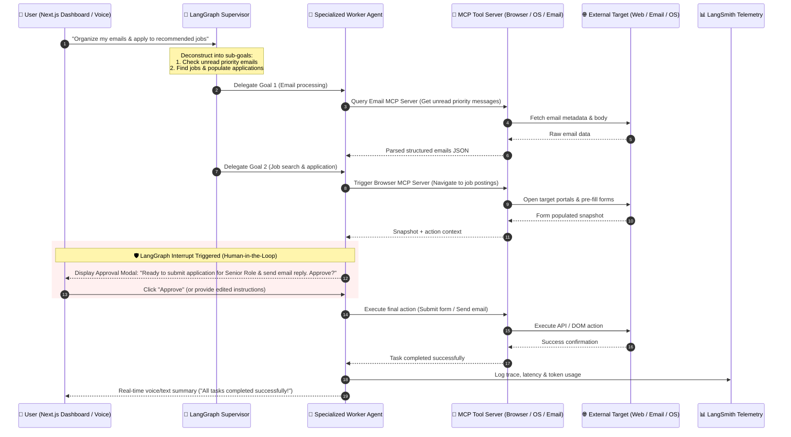
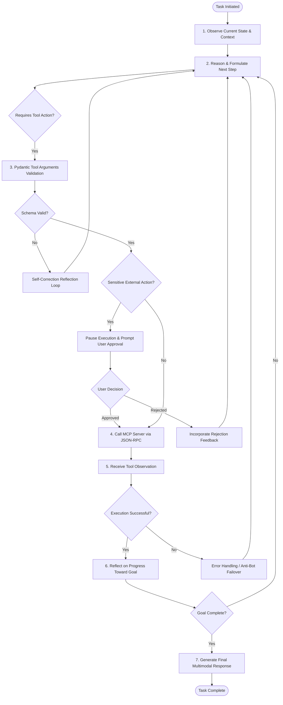
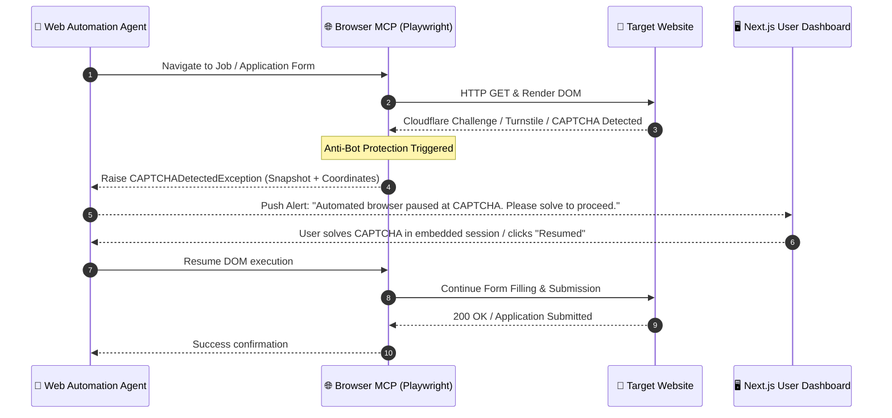
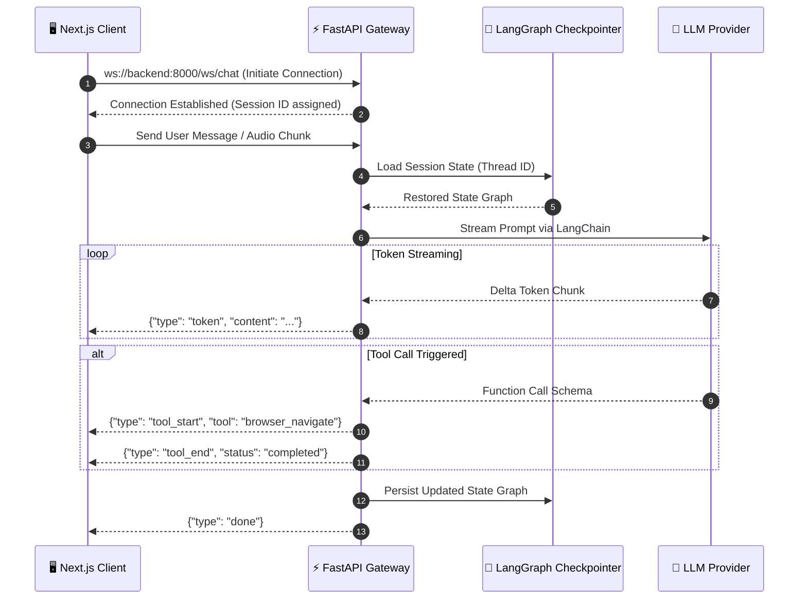

# 🔄 M.I.R.A.S Workflow & Task Execution Diagrams

> [!TIP]
> **Universal Action Flow**: The assistant accepts natural language goals, dynamically formulates execution plans using MCP tools, requests approval for impactful actions, and logs full trace history to LangSmith.

---

## 1. End-to-End Task Execution Workflow (With HITL Authorization)

---

## 2. Multi-Agent Reasoning Cycle (ReAct + Reflection)

---

## 3. Anti-Bot & CAPTCHA Failover Workflow

---

## 4. WebSocket Streaming Lifecycle

